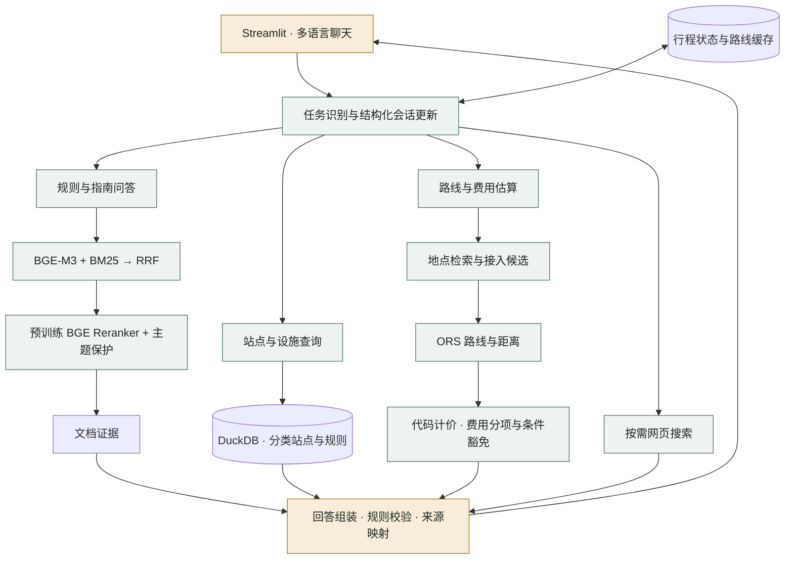

# 港的通 · HK Taxi Assistant

**面向香港乘客与游客的多语言出行助手。**
**A multilingual Hong Kong taxi assistant for locals and visitors.**

将官方资料问答、分类站点查询、路线规划和费用估算接入同一对话入口。支持简体中文、繁體中文与 English，能够结合多轮补充更新行程，并展示回答来源与费用分项。

`Hybrid RAG` · `Cross-encoder Reranking` · `Stateful Tool Orchestration` · `DuckDB` · `Streamlit`

## 功能

| 功能 | 说明 |
|---|---|
| 乘车规则问答 | 查询收费、支付、收据、行李、营运范围和场站指南，附官方资料引用 |
| 路线与费用估算 | 解析起终点、筛选道路接入候选，获取行车距离并计算已知费用 |
| 过海费用分项 | 识别三条过海隧道，处理适用的去程费、回程费及豁免条件 |
| 分类找站 | 使用参数化 SQL 查询普通的士站、过海站及预约候车设施 |
| 多轮行程调整 | 支持补充入口、更换起终点、一个途经点及更新行李和预约条件 |
| 网页补充问答 | 本地证据不足时按需查找网页资料，也支持一般问题，展示网页出处 |
| 聊天界面 | Streamlit 页面提供语言选择、行程摘要、来源展开及本地对话导出 |

示例问题：

- 从香港大学到太平山顶大概多少钱？终点用山顶广场的落客点。
- 上环到尖沙咀，两件行李放尾箱；如果从过海的士站上车，费用有什么区别？
- 的士不收信用卡，收据打印机又坏了，可以怎样付款和拿收据？
- 西九龙有哪些预约候车设施？取消预约，改普通的士站排队后怎么算？

## 架构



混合问题可以执行多个任务分支，当前控制器按顺序调用工具，再统一组装回答。LLM 用于理解问题、生成任务计划和组织文档回答；SQL、路线距离与费用计算由对应工具执行。

## 核心实现

### 混合检索与重排

知识库当前包含 **64 个已审阅文本块**。按标题、问答及完整收费规则组织内容，长单元采用递归字符切分，保留来源及定位信息。

检索使用 BGE-M3 向量召回与 BM25，通过 RRF 合并候选；预训练 `BAAI/bge-reranker-v2-m3` 对查询与候选文本打分。最终返回 Top-5，并通过主题子查询及证据名额保留支付、收据、行李等混合意图所需资料。

### 结构化会话与工具调用

会话显式保存起终点、途经点、候选选择及收费条件。用户补充地点时更新对应字段；更换起点时重置与原上车地点绑定的豁免，取消预约时清除预约专属价格假设。行程未变时可以复用路线缓存。

站点工具使用代码定义的参数化 SQL，区分普通站、过海站及预约设施。目录包含 518 条官方站点记录及 20 条候车设施记录；有坐标时可按直线距离排序。

### 可解释的费用估算

地点检索与道路接入选择分开处理：区域优先采用同名车站附近代表点，景点采用游客接入区域；多个有效候选可生成参考金额范围。

市区的士距离计价及已支持附加费由代码按整数分计算，费用分项关联规则来源。过海判断结合 ORS 收费路段与有来源的隧道线形。对行李尺寸、豁免及收费日期等已定义事实，使用结构化规则和原文证据约束关键表述。

### 引用与语言处理

文档回答使用结构化输出，校验字段及引用 ID，再由程序映射到来源链接。支持简繁转换与英语回答；网页补充回答登记实际返回的网页出处。

## 技术栈

| 层次 | 实现 |
|---|---|
| 应用 | Python 3.12、Streamlit |
| 任务编排与生成 | 原生 Python 控制器、阿里云百炼 Qwen、JSON Schema |
| 检索 | BGE-M3、NumPy、BM25、RRF |
| 重排 | BGE Reranker v2 M3、Transformers、PyTorch CUDA |
| 结构化查询 | DuckDB、参数化 SQL |
| 地点与路线 | 香港地政总署地点 API、OSM、openrouteservice、pyproj |
| 质量验证 | pytest、Streamlit AppTest、事实组检索评测、离线会话回放 |

## 评测

固定 64 块语料、候选集、事实组标签、Top-k 及主题保护策略，对比重排前后的检索结果：

| 检索配置 | 平均事实 Recall@5 | 必要证据全部覆盖@5 | 平均事实 Recall@3 |
|---|---:|---:|---:|
| 混合检索 | 93.9% | 103 / 113 | 86.4% |
| 混合检索 + 预训练重排 | **97.1%** | **106 / 113** | **90.1%** |

共检查 132 道开发／回归题，其中 113 道具有完整文档证据的题计入主指标。每题按必要事实组计算覆盖比例，同一事实的等价证据均可计入；Recall 为逐题平均值。该结果衡量检索证据覆盖，**不代表最终回答准确率或独立盲测成绩**。

工具回归覆盖行程继承、预约状态切换、设施分类、计价边界及费用豁免。费用估算尚未建立真实咪表行程误差指标。

## 主要目录

```text
streamlit_app.py          聊天页面
start_web.cmd            Windows 启动器
src/hk_taxi/             会话编排、检索、SQL、地图、费用与回答校验
configs/                 运行参数与规则配置
prompts/                 提示词、任务计划和回答 Schema
data/curated/            已切分语料、主题标签和站点数据
data/manifests/          数据来源清单与输入校验
data/reference/          场站、收费规则、原文证据及隧道资料
evaluation/              评测问题、标签、评分规则与指标
scripts/                 数据准备及运行检查脚本
tests/                   自动化回归
docs/                    使用及实现说明
```

## 安装与本地运行

不需要租用服务器或部署公网网站。下载项目后在自己的电脑运行，通过浏览器打开本地页面即可。

当前验证环境为 **Windows、Python 3.12、NVIDIA CUDA**。Embedding 在 CPU 运行，默认预训练 reranker 在 GPU 运行；其他平台及纯 CPU 配置尚未验收。

在项目目录执行（PowerShell、CMD、Anaconda Prompt 均可）：

```bat
python -m venv .venv
.venv\Scripts\python.exe -m pip install -r requirements-runtime.lock.txt
.venv\Scripts\python.exe -m pip install -e . --no-deps --no-build-isolation
```

复制 `.env.example` 为 `.env`，填写自己的百炼 API Key、对应 Base URL 和可调用的模型 ID，以及用于路线查询的 ORS Key。然后执行：

```bat
.venv\Scripts\python.exe scripts/setup.py
.\start_web.cmd
```

仓库附带 **64 块已清理切分语料、518 条站点记录、20 条设施记录及所需规则和证据**。初始化自动下载固定版本的两套模型，并在本机建立 SQL 数据库、生成语料向量及检索索引；**无需自行下载文档、OCR、切分或标注**。

两套模型必要文件合计约 4.59 GB，首次初始化需要网络、时间和足够磁盘空间；模型 API 的额度与费用由使用者自己的账号承担。后续启动不需要重新准备语料。模型权重、生成物、凭据和个人对话不随仓库发布。

默认打开 [http://127.0.0.1:8501/](http://127.0.0.1:8501/)，终端按 Ctrl+C 停止；可用 `start_web.cmd --server.port 8502` 修改端口。

[完整安装、CMD 与 Anaconda Prompt 说明](docs/installation.md) · [数据与索引说明](docs/data_preparation.md) · [评测方法](docs/evaluation.md)

## 使用范围

- 费用估算目前支持市区的士距离计价、已识别过海隧道及适用附加费；等待费和其他道路收费尚未开启。
- 区域粗估会标明采用的代表地点；金额范围来自实际计算的候选路线。
- 站点信息来自资料快照；预约及取消仅更新会话条件，不执行真实订单操作。
- 外部模型、地图及搜索服务的可用性取决于相应账号权限与网络条件。

## 数据来源

官方规则与站点资料主要来自香港运输署、政府公告及相关场站的官方指南，地点检索使用香港地政总署服务，路线使用 openrouteservice；OSM 用于辅助接入点与隧道几何识别。

参见 [来源清单](data/manifests/sources.json)、[数据准备说明](docs/data_preparation.md) 和 [隧道几何来源说明](data/reference/harbour_geometry_LICENSE.txt)。第三方资料和模型沿用各自的来源及许可说明。

本项目仅允许个人学习及日常使用。数据与第三方组件归属见 [NOTICE.md](NOTICE.md)。
